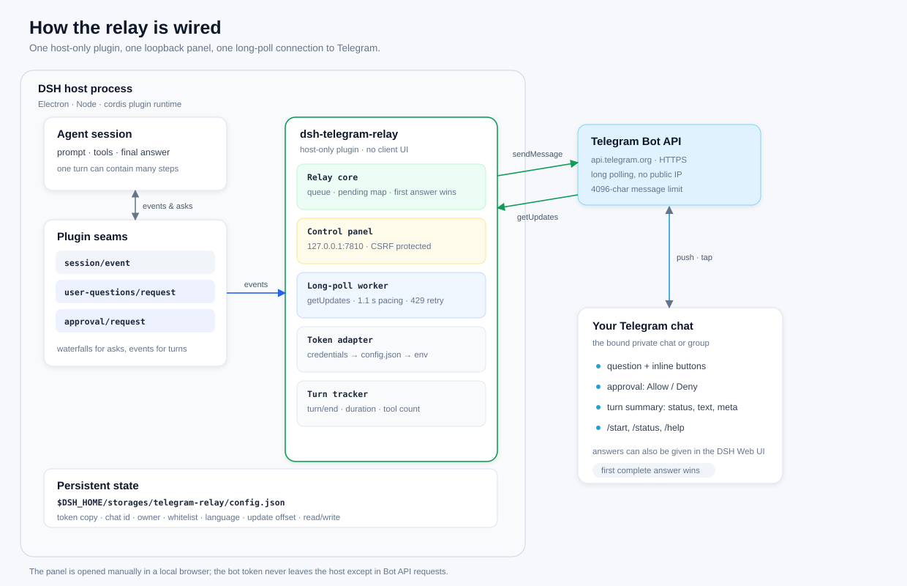
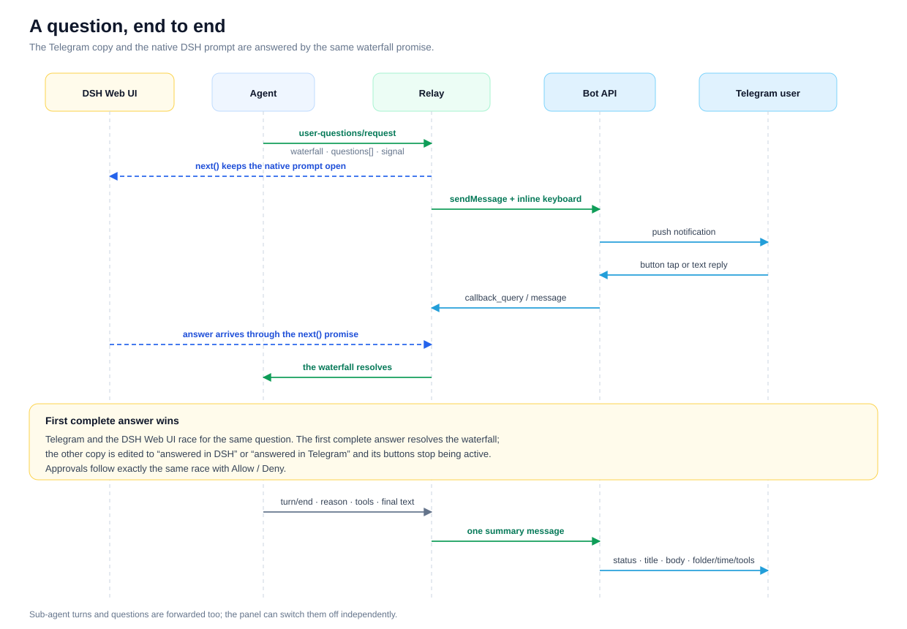
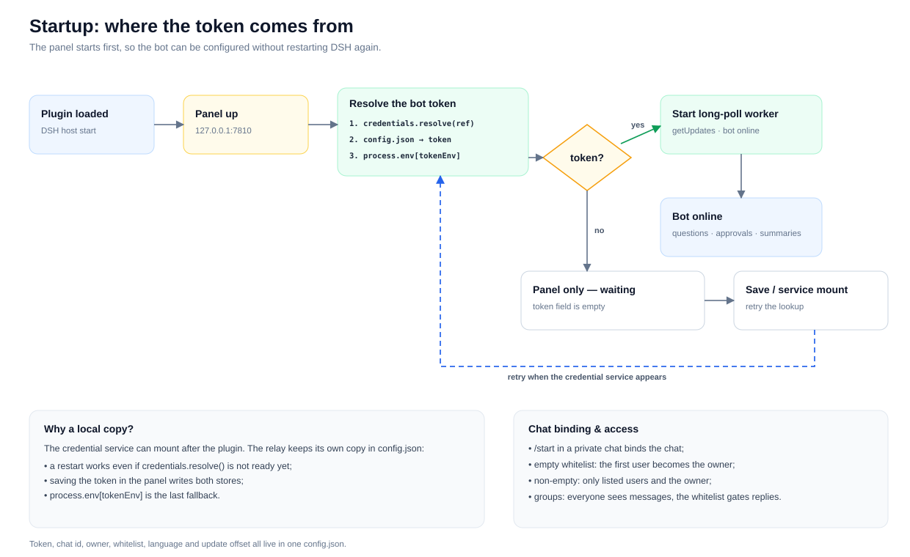
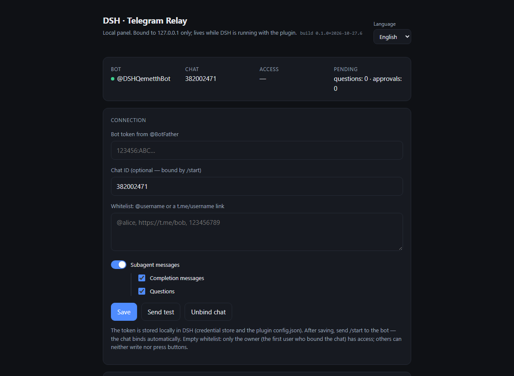
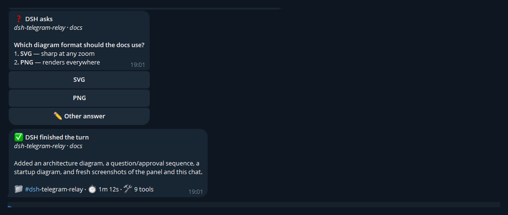

# How dsh-telegram-relay works

This document explains the moving parts and the request flow behind the plugin. The
[main README](../README.md) covers installation, configuration and the bot commands.

- [Architecture](#architecture)
- [A question, end to end](#a-question-end-to-end)
- [Startup and token resolution](#startup-and-token-resolution)
- [Screenshots](#screenshots)
- [Source map](#source-map)
- [Design decisions](#design-decisions)

## Architecture



The plugin lives **inside the DSH host process**. It is host-only: there is no client
bundle, no extra window and no change to the model prompt.

The relay subscribes to three seams:

| Seam | Kind | What the relay does |
|---|---|---|
| `session/event` | event | Tracks `turn/start`, `step/start`, tool calls, assistant text and `turn/end`; builds the summary at the end. |
| `user-questions/request` | waterfall | Sends the question to Telegram and waits, while calling `next()` so the native DSH question stays usable. |
| `approval/request` | waterfall | Sends Allow / Deny buttons, while passing the request to the native approval UI. |

The **control panel** is a small HTTP server bound to `127.0.0.1`. It is the only place
where the bot token, chat id, whitelist and language are configured. Every `POST`
requires a per-process CSRF token, and the server never binds a public interface.

The **long-poll worker** calls `getUpdates` over outbound HTTPS, so no public IP,
webhook or TLS certificate is needed. Outgoing messages use `sendMessage`; a question
message is edited in place when it is answered or cancelled.

State is kept in one file:

```text
$DSH_HOME/storages/telegram-relay/config.json
```

It holds the local token copy, the bound chat id and owner, the whitelist, the selected
language and the last Telegram update offset. The DSH credential store remains the
primary token storage; the local copy is what makes a restart independent of service
load order.

## A question, end to end



1. The agent asks a question. DSH runs the `user-questions/request` waterfall.
2. The relay calls `next()` immediately, so the DSH Web UI still shows its own question
   dialog. The relay then sends a Telegram copy with inline buttons.
3. Either side can answer: a button tap, a text reply to the question message, or the
   native DSH dialog. A question without options accepts a plain text message when it is
   the only pending question; for a question with options, use the buttons or reply to
   the message after tapping **Other answer**.
4. The first **complete** answer resolves the waterfall. For a multi-question request,
   every question must have a selection or custom text; multi-select questions use
   toggle buttons plus **Done**.
5. The other copy is edited to “answered in DSH” or “answered in Telegram”, and its
   buttons stop being active. If the request is aborted, the Telegram message is marked
   as cancelled.

Approvals use the same race: **Allow** returns `allowed-once`, **Deny** returns
`rejected`, and the native approval prompt can still decide first.

After the last step of a turn — root or subagent, when subagent completion messages are
enabled — the relay closes the turn from `turn/end` and renders one summary message:

```text
✅ DSH finished the turn
the session title
final text …
📁 #folder · ⏱️ 1m 12s · 🛠 9 tools
```

The folder/time/tools line always goes last. Markdown is converted to Telegram HTML;
fenced code, links, quotes and spoilers are supported. Sub-agent sessions are forwarded
too, and can be switched off independently — see [Sub-agent messages](#sub-agent-messages).

## Startup and token resolution



Startup order matters: the credential service may mount **after** this plugin. The relay
therefore starts the panel first and resolves the token in this order:

1. `credentials.resolve('TELEGRAM_RELAY_BOT_TOKEN')` when the service is available;
2. the local `config.json` copy;
3. `process.env.TELEGRAM_RELAY_BOT_TOKEN`.

If no token is found, the panel still opens and shows an empty token field. When the
credential service appears, `ctx.inject(['credentials'], …)` (registered after
`start()`) triggers a retry; saving the token in the panel also starts the bot
immediately and writes the local copy (and the credential store when available). That
means a restart never asks for the token twice.

Binding is separate from the token:

- `/start` in a private chat binds that chat; with an empty whitelist the first user
  becomes the owner.
- With a non-empty whitelist only listed users and the owner can bind, write and press
  buttons.
- In a group that you bound manually by its chat id, every member sees the messages; the
  whitelist still gates who can answer.
- **Unbind chat** clears the chat id and the owner; the whitelist is kept.

## Sub-agent messages

Subagent sessions are forwarded by default. The panel has a **Subagent messages** master
switch; when it is on, two checkboxes appear underneath:

| Checkbox | Config key | Default | Covers |
|---|---|---|---|
| **Completion messages** | `notifySubagentTurnEnd` | `true` | Turn summaries from subagent sessions. |
| **Questions** | `notifySubagentQuestions` | `true` | Subagent questions and approval prompts. |
| Master switch | `notifySubagents` | `true` | Both of the above. |

Turning the master switch off suppresses both kinds without clearing the checkboxes; the
previous choices come back when it is switched on again. The general `notifyTurnEnd`,
`notifyQuestions` and `notifyApprovals` settings still apply to every session, so the
subagent switches are an additional layer rather than a replacement. Root-session
behaviour is unchanged. All three choices are saved in `config.json` and survive a
restart.

## Screenshots

### Control panel



The real panel, with the language set to English. The token field is intentionally blank:
a stored token is loaded from the credential store and is never echoed back into the
page. The header shows the running build marker — the quickest way to confirm which code
the host actually loaded. The panel is opened manually at `http://127.0.0.1:7810` (or the
fallback port stored as `panelUrl`). The **Subagent messages** switch sits below the
whitelist, with the two nested checkboxes visible because it is on.

### Telegram chat



A sample question with inline buttons, followed by the summary for the turn that asked
it. The screenshot is taken from a real Telegram client; the message text is a
documentation fixture, not a live session.

## Source map

| File | Responsibility |
|---|---|
| `lib/index.js` | Plugin entry point: creates the relay, registers disposal, wires the late credentials retry. |
| `lib/relay.js` | Orchestration: session tracking, question and approval waterfalls, binding, whitelist, token resolution, summary construction. |
| `lib/telegram.js` | Bot API transport: long polling, queue pacing, 429 retry, message edits, callback answers. |
| `lib/server.js` | Loopback control panel: HTML, CSRF, `/api/state`, `/api/config`, `/api/test`, `/api/reset`. |
| `lib/format.js` | Markdown → Telegram HTML, clipping and message splitting. |
| `lib/i18n.js` | Russian, English and Chinese dictionaries, system-locale detection, duration and tool formatting. |
| `tests/` | Formatting, summary, panel and end-to-end flow tests; no network access. |

## Design decisions

- **Host-only plugin.** DSH already has a Web UI; the relay adds a transport, not a
  second interface. This keeps the client bundle and the model prompt untouched.
- **Long polling.** Works behind NAT and needs no public endpoint, at the cost of one
  persistent outbound connection.
- **Race instead of routing.** The relay never takes the question away from the Web UI.
  Both interfaces resolve the same promise, so the user can answer wherever they are.
- **Two token stores.** The credential store is the canonical place, but the local copy
  removes the dependency on plugin/service start order — the failure mode that used to
  lose the token after a restart.
- **Whitelist and owner.** A bot username is public; without an access rule anyone who
  finds it could read summaries or answer questions. The whitelist closes that hole
  before the first `/start`.
